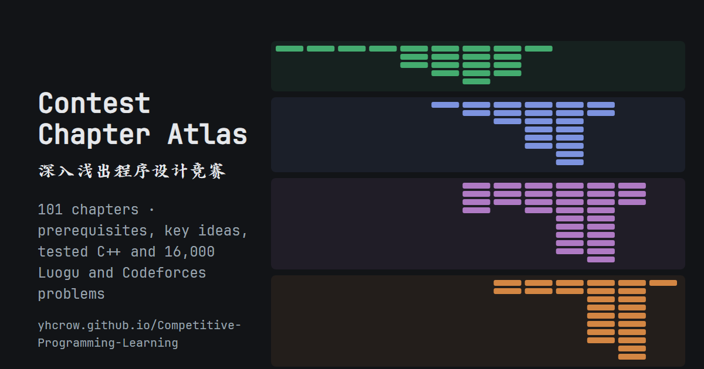

# Contest Chapter Atlas

A study map for the 101 chapters of the 深入浅出程序设计竞赛 handouts (基础篇, 进阶篇, 拓展篇, NOI篇), for C++ contest students.

**Open the site:** https://yhcrow.github.io/Competitive-Programming-Learning/

## What's in it

- **The map.** Every chapter placed by its prerequisites, one lane per level. Point at a chapter to light up what it needs and what it unlocks; click it for its details. "Ready only" dims what you can't start yet, "Fold finished levels" shrinks a completed level to one bar, and search highlights matching chapters on the map.
- **A goal.** Pick a chapter you want to reach and the map outlines the shortest chain of chapters you still need, in order. "Continue" follows it, and one click puts the next five in your study queue.
- **Chapter pages.** The handout's text with its Idea, Key point and Trap boxes, every C++ program (folded until you open it) with sample input and output, step-by-step visualizers for 22 chapters, and the handout PDF.
- **An honest "Learned".** Before a chapter is marked learned, a quick self-check asks you to recall three of its boxes.
- **Your mistakes.** Note a bug you made with a technique, and it shows at the top of that chapter the next time.
- **Problem lists.** Each chapter's Luogu (8,895 in total) and Codeforces (7,557) problems, easiest first, with ★ on the ones that test exactly that chapter's technique, a three-tier practice ladder, and a 题解 link once you've solved one (or press Stuck?).
- **Practice.** A problem of the day, contest mode (four problems against a 1 to 3 hour timer), flashcards of every Trap and Key point, a bilingual glossary of about 190 terms, and a constraint calculator that turns n and the time limit into the complexity you need.
- **Progress.** Chapters learned, review reminders at 7, 21 and 60 days, a study heatmap, milestones, mastery by topic. Save a backup file, share a read-only link to your map, or download a picture of your progress.
- **Works offline.** Add it to your phone's home screen; after the first visit it opens with no signal, and handout PDFs you've opened stay available.

Progress is saved in your browser only. Download a backup file from the Progress page to keep it safe or move it to another device.

Keys: `/` or `Ctrl K` search, `1` to `5` switch views, `j` / `k` next and previous chapter, `Space` flips a flashcard.

## Files

| Path | Contents |
| --- | --- |
| `index.html` | The whole site (no build step) |
| `atlas.json` | Chapters, prerequisites, concept boxes and programs |
| `problems.json` | Luogu and Codeforces problems per chapter |
| `handouts/` | Each chapter's PDF and text (`b` 基础篇, `j` 进阶篇, `t` 拓展篇, `n` NOI篇) |
| `sw.js`, `manifest.webmanifest`, `icon-*.png` | The offline copy and the home-screen app |
| `share.png` | The picture shown when the link is shared |

To run it locally, serve the folder (for example `python -m http.server`) and open `http://localhost:8000`. Opening `index.html` straight from disk won't load the data.

A GitHub Action checks on every push that the page script parses, the data is valid JSON and every chapter has its files.
